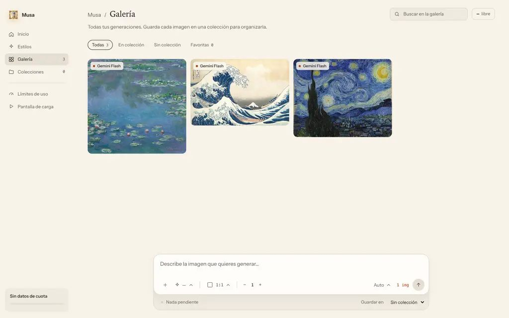

# Musa

[](LICENSE)
[]()

Servidor **MCP (stdio)** y CLI **`musa`** para generar y editar imágenes con **tu propia sesión web de Gemini** (cookies del navegador), sin API key de pago. Incluye **Musa**, una app web local para organizar y generar: galería, estilos con imagen de referencia, colecciones y generación con cola.



**Características**

- 🤖 MCP con 37 tools (`generate_image`, `edit_image`, `list_generations`, colecciones, Gems de estilo, prompts guardados, animaciones y composiciones…) y CLI `musa` equivalente.
- 🖼️ Referencias locales/URL/`gen:<id>` (hasta 10, 20 MB, validadas por magic bytes y anti-SSRF), estilos con imagen de referencia, plantillas con variables, 10 proporciones.
- 🗂️ **Musa** (`musa app`): app local en `127.0.0.1` con clave por arranque — galería, generación con cola, colecciones, estilos, Gems y pantalla de cuota real.
- 🧠 **Gems de estilo**: cada estilo puede usar un Gem de tu cuenta de Gemini para salidas más consistentes.
- 🔒 Chats temporales por defecto (no ensucian tu historial de Gemini), logs sin secretos, estado local con permisos restrictivos.

Arquitectura: `agente MCP / CLI musa → capa de servicio (refs, estilos, almacenamiento, estado) → client.py (cliente nativo interno en upstream/) → gemini.google.com`.

## ⚠️ Advertencia: Términos de Servicio y estabilidad

- Automatizar `gemini.google.com` puede quedar **fuera de los Términos de Servicio de Google**. Las consecuencias (límites, bloqueos, suspensión) recaen sobre tu cuenta.
- **Usa una cuenta Google secundaria dedicada que tenga la suscripción**, no tu cuenta principal.
- Se usa una API web interna **no oficial** mediante un cliente nativo asíncrono (`src/musa/upstream/`) con `curl_cffi` para impersonar TLS/HTTP2 de navegador. Google puede modificar sus endpoints o payloads sin aviso; en caso de desajustes, ejecuta el E2E manual de abajo.
- **No uses el contenido generado para entrenar modelos**: lo prohíbe el ToS.

## Instalación

Requisitos: **macOS, Linux o Windows**, [uv](https://docs.astral.sh/uv/) (instala Python 3.11+ por ti si hace falta) y **Firefox** (en macOS, `/Applications/Firefox.app`; en Windows, la ruta de instalación estándar; en otro sitio, `GIA_FIREFOX_PATH`). `musa auth` abre Firefox como un navegador normal con un perfil propio en `<state_dir>/firefox-profile`: Google rechaza el inicio de sesión en navegadores automatizados ("This browser or app may not be secure"), y Chromium no sirve por las cookies de sesión ligadas al dispositivo.

### Para usarlo (recomendado)

```bash
curl -LsSf https://astral.sh/uv/install.sh | sh                          # 1. instala uv (si no lo tienes)
uv tool install git+https://github.com/CongrooDevs/Musa-Image.git        # 2. instala musa, musa-mcp y Musa
musa auth                                                                 # 3. inicia sesión en Gemini (abre Firefox)
musa app                                                                  # 4. abre Musa en el navegador
```

Quedan instalados los comandos `musa` (CLI y Musa) y `musa-mcp` (servidor MCP) en `~/.local/bin`. Si tu terminal no los encuentra, ejecuta `uv tool update-shell` y abre otra terminal.

### Para desarrollar

```bash
git clone https://github.com/CongrooDevs/Musa-Image.git && cd Musa-Image
uv sync --extra test
uv run musa auth
uv run musa app          # Musa con el código del repositorio
uv run pytest -q        # tests
```

### Actualizaciones

> **¿Lo tenías instalado como `gia`?** Los comandos se llaman ahora `musa` y `musa-mcp`. Actualiza una última vez con `gia update` (o `uv tool install --force git+https://github.com/CongrooDevs/Musa-Image.git`): después `gia` desaparece y se usa `musa`. Cambia también tu configuración MCP de `"command": "gia-mcp"` a `"command": "musa-mcp"` y reinicia el agente. Tus datos (`~/.gemini-image-api`, `~/Pictures/gemini-image-api`) y las variables `GIA_*` no cambian.

- **Aviso automático:** Musa y `musa update --check` comparan tu versión con el último commit de `main` en GitHub (como mucho una consulta cada 24 h, guardada en `<state_dir>/update_check.json`). Si hay una versión nueva, Musa muestra la píldora **«Actualización»** en la barra superior.
- **Instalar la nueva versión:** `musa update` (equivale a `uv tool install --force git+https://github.com/CongrooDevs/Musa-Image.git`). Después, cierra y vuelve a abrir Musa (`musa app`) y reinicia tu agente si usa `musa-mcp`.
- La actualización **no es silenciosa**: siempre la lanzas tú. Tus imágenes, estilos, prompts, colecciones, animaciones, composiciones y cookies viven en `~/.gemini-image-api` y `~/Pictures/gemini-image-api`, y no se tocan al actualizar.
- El aviso solo funciona en instalaciones hechas con `uv tool install git+…` (que guardan el commit instalado) o en un clon del repositorio; en otros casos `musa update --check` no puede saber tu versión.

## Primer uso

```bash
musa auth                        # abre Firefox: inicia sesión en gemini.google.com; se cierra solo al detectar la cookie (o a los 5 min)
musa gen "un gato astronauta"    # genera una imagen
musa auth --status               # comprueba la sesión
```

(Desde un clon del repositorio, antepón `uv run`.) Las cookies quedan en `<state_dir>/cookies/` con permisos `0600` (`<state_dir>` es `~/.gemini-image-api` por defecto; configurable con `GIA_STATE_DIR`).

## ChatGPT (web)

Musa también genera y edita con **tu sesión web de ChatGPT** (vale una cuenta Free): elige el modelo **«ChatGPT (web)»** (`chatgpt-web`) en el selector, en `musa gen --model chatgpt-web` o en `generate_image(model="chatgpt-web")`. Las ediciones, `retry_download` y `delete_conversation` siguen solas al proveedor de su conversación.

> ⚠️ **Términos de uso:** los Términos de OpenAI prohíben extraer contenido generado de forma automática o programática. Este canal automatiza chatgpt.com y descarga las imágenes. El riesgo sobre tu cuenta es tuyo.

- **Requisito:** Google Chrome (en macOS, `/Applications/Google Chrome.app`; en Windows, la ruta de instalación estándar; en otro sitio, `GIA_CHROME_PATH`).
- **Inicio de sesión:** `musa auth --chatgpt` (o `auth_login(provider="chatgpt")`) abre Chrome **sin automatizar** con un perfil propio en `<state_dir>/chatgpt-chrome-profile`. Inicia sesión y Chrome se cierra solo al detectar la cookie. En Windows, Chrome bloquea su archivo de cookies mientras está abierto: tras iniciar sesión, **cierra Chrome** y Musa comprueba la sesión.
- **Generación:** Musa abre ese perfil en Chrome **headless**, sin puerto de depuración, y lo cierra tras 2 min sin uso. Solo un proceso puede usar el perfil a la vez: si Musa y musa-mcp coinciden, el segundo espera.
- **Historial:** las conversaciones quedan en tu barra lateral de ChatGPT. `musa delete` / `delete_conversation` las oculta.
- **Cuota:** `musa auth --status --chatgpt` muestra `image_gen.remaining` y `reset_after` según la última llamada. Musa no supone ningún límite fijo.
- **Gems:** ChatGPT no los usa. El estilo se aplica como texto (aviso `gem_ignored`).

## Registrar el MCP en tu agente

El mismo bloque sirve para **omp**, **Claude Code**, **Claude Desktop** y **Cursor** (en su archivo de configuración MCP respectivo):

```json
{
  "mcpServers": {
    "musa": {
      "command": "/ruta/absoluta/a/uv",
      "args": ["run", "--project", "<ruta-al-repo>", "musa-mcp"]
    }
  }
}
```

Se usa `--project` y no `--directory` para que el servidor arranque siempre sobre el repo, pero **sin cambiar el directorio de trabajo del agente**: ese cwd es el "directorio de trabajo" que usa la allowlist de refs y `copy_to`. El `command` lleva la ruta absoluta de `uv` porque los agentes MCP no siempre tienen el PATH del usuario. Si `musa-mcp` está en el PATH, basta `"command": "musa-mcp"` sin `args`. Para imprimir este JSON con las rutas reales:

```bash
uv run musa mcp-config
```

## Tools MCP

Hay 37 tools: `generate_image`, `edit_image`, `generate_batch`, `retry_download`, `delete_conversation`, `auth_status`, `auth_login`, `list_styles`, `list_style_gems`, `style_gem`, `create_style`, `update_style`, `delete_style`, `describe_style`, `list_templates`, `list_models`, `list_generations`, `get_image`, `favorite_image`, `delete_image`, `list_collections`, `add_to_collection`, `remove_from_collection`, `rename_collection`, `delete_collection`, `list_prompts`, `save_prompt`, `update_prompt`, `delete_prompt`, `generate_animation`, `set_animation`, `export_animation`, `generate_composition`, `list_compositions`, `get_composition`, `export_composition` y `set_layer_animation`.

Las tools de generación (`generate_image`, `edit_image`) devuelven el contrato `{status, code, conversation_id, images[], gemini_text, elapsed_s, quota}` como `structured_content` (y el mismo JSON como bloque de texto). `quota` es `{tier, window_5h_pct, weekly_pct, resets_at_5h, resets_at_weekly}` (`tier` puede ser `null` si Google no devuelve datos). `status` es `ok`, `error` o `generated_not_saved` (se generó pero falló el guardado; en ese caso `code` también es `generated_not_saved` y el payload añade `details.reason`). Cada elemento de `images[]` incluye `path`, `width`, `height`, `bytes`, `format`, `full_size` e `index`, y además `copied_to` (o `copy_error`) cuando se usó `copy_to`. Con `return_image=true` (por defecto) se añade además un **bloque de imagen MCP** por imagen con una miniatura JPEG de 512 px (unos 40-80 KB), que los agentes multimodales ven como imagen; nunca va como base64 dentro del JSON. En error: `status: "error"`, `code`, `message`, `details` y los campos nuevos `retryable` (bool) y `next_action` (qué hacer; ver tabla de errores).

| Tool | Parámetros clave | Devuelve |
|---|---|---|
| `generate_image` | `prompt`, `refs[]`, `style`, `style_text`, `template`, `template_vars`, `aspect_hint`, `model`, `project`, `subdir`, `copy_to`, `collection`, `return_image` | Contrato de generación (chat nuevo) |
| `edit_image` | `conversation_id`, `prompt`, `refs[]`, `style`, `style_text`, `template`, `template_vars`, `aspect_hint`, `model`, `project`, `subdir`, `copy_to`, `collection`, `return_image` | Contrato de generación (continúa la conversación) |
| `retry_download` | `conversation_id`, `image_index` | `{status, code, image{path,width,height,bytes,format,full_size}}`; reintenta solo la descarga, sin regenerar ni gastar cuota |
| `delete_conversation` | `conversation_id` | `{status, code, conversation_id}`; borra en Gemini y marca en el historial local |
| `auth_status` | — | Estado de la sesión: cookies, validez, modelos, imágenes hoy, estado de la cuenta, antigüedad de la cookie (`cookie_age_s`) y cuota Google (5h/semanal %); incluye el sub-objeto `chatgpt` `{session, image_gen}` |
| `auth_login` | `provider?` (`gemini` \| `chatgpt`) | Login guiado. `gemini` (por defecto): abre Firefox (perfil propio), inicia sesión en gemini.google.com; el navegador se cierra solo al detectar la cookie (o tras 5 min → `auth_expired` "login timeout"). `chatgpt`: abre Chrome sin automatizar con su perfil propio. El perfil persiste, así que los siguientes logins suelen ser instantáneos |
| `list_styles` | — | `{nombre: descripción}` |
| `list_style_gems` | — | `{status, gems: [{style, gem_id, name, custom}]}`; solo lectura |
| `style_gem` | `style`, `enabled`, `instructions?` | Activa/desactiva el Gem de un estilo (ver «Gem de estilo»): `enabled=true` lo crea, o actualiza `instructions` si las pasas; `enabled=false` lo borra. Devuelve `{style, gem: {gem_id, name, custom} \| None}` |
| `list_templates` | — | `{nombre: {description, vars}}` |
| `list_models` | — | `{status, code, models, resolved_default}`: modelos de chat reales de tu cuenta (el modelo determina la variante de imagen) y `resolved_default: {requested, resolved}`, el modelo por defecto configurado (`default_model`) y el nombre al que se resuelve en tu cuenta (ver «Modelos») |
| `list_generations` | `query`, `project`, `since`, `status`, `collection`, `model`, `limit` (1-100), `offset` | Generaciones pasadas (más reciente primero); sus `id` sirven como refs `gen:<id>[#index]` y sus `conversation_id` para `edit_image`. `collection` filtra solo las de esa colección; `model` filtra por id de modelo exacto (ver `list_models`) |
| `list_collections` | — | Colecciones (etiquetas): `[{id, name, description, count}]` |
| `add_to_collection` | `image` (`gen:<id>[#index]`), `collection` (nombre o id; se crea si no existe) | Añade una imagen existente a una colección (idempotente) |
| `create_style` | `name`, `instructions`, `description?`, `family?` (`otros`), `image?` | `{status, style}`; crea un estilo propio (el id se deriva del nombre); `image` (ruta permitida, URL https o `gen:<id>[#index]`) se envía a Gemini como primera ref |
| `update_style` | `style`, `name?`, `instructions?`, `description?`, `family?`, `image?`, `remove_image?` | Edita un estilo propio; los campos omitidos se mantienen y el id no cambia; sincroniza su Gem si está activo. Los estilos integrados se rechazan (`invalid_style`) |
| `delete_style` | `style` | `{status, deleted}`; borra un estilo propio y su Gem. Los integrados se rechazan (`invalid_style`) |
| `describe_style` | `style`, `prompt?` | Detalles del estilo y el prompt exacto que se enviaría, sin llamar a Gemini; solo lectura |
| `rename_collection` | `collection`, `name`, `description?` | Renombra una colección (y opcionalmente cambia su descripción) |
| `delete_collection` | `collection` | Borra una colección; sus imágenes se conservan |
| `remove_from_collection` | `image`, `collection` | Quita una imagen de una colección (la imagen se conserva) |
| `favorite_image` | `image`, `favorite` (`true` por defecto) | Marca o desmarca una imagen como favorita |
| `get_image` | `image` | Ruta, prompt, estilo, modelo, tamaño, favorita, colecciones y `conversation_id` de una imagen; solo lectura |
| `delete_image` | `image` | Borra **solo local**: el archivo y la miniatura, y la oculta del historial; la copia en Gemini no se toca |
| `generate_batch` | `prompts[]` (1-8), `style`, `collection`, `aspect_hint`, `model`, `project`, `subdir` | Genera varias imágenes con opciones compartidas, cada prompt en un chat nuevo y en serie (cada una gasta cuota). Devuelve `{status: ok\|partial\|stopped, results, stopped_at}`; se detiene ante `quota_guard`, `usage_limit`, `auth_*` (`auth_expired`/`auth_failed`) o `temporarily_blocked` |
| `list_prompts` | — | `{status, prompts: [{id, name, text, created, uses}]}`; prompts guardados, los más usados primero; solo lectura |
| `save_prompt` | `name` (único sin distinguir mayúsculas, máx. 80), `text` (máx. 4000) | `{status, prompt}`. **No es idempotente**: un nombre duplicado falla con `invalid_prompt` (usa `update_prompt` para cambiar uno) |
| `update_prompt` | `prompt`, `name?`, `text?` | Renombra y/o cambia el texto de un prompt guardado; los campos omitidos se mantienen |
| `delete_prompt` | `prompt` | Borra un prompt guardado |
| `generate_animation` | `prompt`, `grid` (`4x2`/`3x3`/`2x2`), `mode` (`sprite`/`scene`), `key_color` (`green`/`magenta`), `refs[]`, `style`, `style_text`, `model`, `project`, `subdir`, `copy_to`, `collection`, `return_image` | Contrato de generación + `animations[]`; gasta 1 imagen (ver «Animaciones») |
| `set_animation` | `image`, `cols`, `rows`, `mode`, `key_color`, `tolerance`, `fps`, `loop`, `redetect` | `{status, animation}`; convierte o ajusta una imagen, sin cuota |
| `export_animation` | `image`, `copy_to` | `{status, png, json, animation}`; hoja PNG normalizada + JSON |
| `generate_composition` | `prompt`, `pieces[]` (1–6), `name`, `refs[]`, `style`, `aspect_hint`, `model` | `{status: ok\|partial, composition, quota}`; gasta 2 + n imágenes (ver «Composiciones») |
| `list_compositions` | — | `{status, compositions}` con el estado de cada capa; solo lectura |
| `get_composition` | `composition` | `{status, composition}`; solo lectura |
| `export_composition` | `composition`, `copy_to`, `webp` (`false`) | `{status, zip}` (y el WebP animado con `webp=true`) |
| `set_layer_animation` | `composition`, `layer`, `animation` (`static` o `motion`) | Ajusta el movimiento de una capa, sin cuota |

En `update_prompt` y `delete_prompt`, `prompt` es el id (`pr_xxxxxxxx`) o el nombre (sin distinguir mayúsculas) del prompt guardado; si no existe, `unknown_prompt`. Para usar un texto guardado, léelo con `list_prompts` y pásalo como `prompt` a `generate_image`/`edit_image`/`generate_batch`. Se pueden guardar como máximo 200 prompts.

`refs[]` admite rutas locales (dentro de `output_root` o del directorio de trabajo), URLs http/https públicas, o `gen:<id>[#index]` de `list_generations` (máx. 10). `copy_to` es una ruta opcional (directorio o archivo) dentro de `output_root` o del directorio de trabajo donde también se copia el resultado.

`aspect_hint` admite exactamente `1:1`, `4:5`, `3:4`, `2:3`, `9:16`, `5:4`, `4:3`, `3:2`, `16:9` y `21:9` (se traduce a texto en el prompt; Gemini lo trata como **pista** y no lo garantiza). Los mismos 10 valores valen en `--aspect` de la CLI (`musa gen`/`musa edit`). Cualquier otro valor devuelve error `invalid_aspect` (con `details.valid`).

## Comandos CLI

| Comando | Descripción |
|---|---|
| `musa gen PROMPT` | Genera imagen (chat nuevo). Opciones: `-r/--ref` (repetible), `--style`, `--style-text`, `--template`, `-v/--var k=v` (repetible), `--aspect`, `--project`, `--subdir`, `--copy-to`, `--collection`, `--model` |
| `musa edit CONVERSATION_ID PROMPT` | Edita la imagen de una conversación existente (mismas opciones que `gen`, incluidos `--copy-to` y `--collection`) |
| `musa auth [--status] [--chatgpt]` | Login guiado (Firefox para Gemini; Google Chrome con `--chatgpt`) o comprobación de sesión (`--status --chatgpt` muestra solo ChatGPT) |
| `musa styles` | Lista estilos y plantillas |
| `musa styles gems` | Lista los Gems de estilo activos: `[{style, gem_id, name, custom}]` |
| `musa styles gem ESTILO on\|off [--instructions TEXTO]` | Activa (`on`) o desactiva (`off`) el Gem de un estilo (ver «Gem de estilo»); `--instructions` fija instrucciones personalizadas (cadena vacía: restaura la plantilla) |
| `musa styles add NOMBRE --instructions TEXTO [--description TEXTO] [--family GRUPO] [--image REF]` | Crea un estilo propio; `--family` por defecto `otros`; `--image` admite ruta permitida, URL https o `gen:<id>[#index]` |
| `musa styles edit ESTILO [--name] [--instructions] [--description] [--family] [--image] [--remove-image]` | Edita un estilo propio; los campos omitidos se mantienen |
| `musa styles rm ESTILO` | Borra un estilo propio (y su Gem) |
| `musa styles show ESTILO [--prompt TEXTO]` | Muestra el estilo y el prompt exacto que enviaría (sin llamar a Gemini) |
| `musa history` | Generaciones pasadas (más reciente primero); sus id sirven como refs `gen:<id>[#index]`. Opciones: `--query`, `--project`, `--since`, `--status`, `--collection`, `--model` (id de modelo exacto), `--limit` (20), `--offset` |
| `musa models` | Modelos de chat disponibles en tu cuenta |
| `musa prompts` | Lista los prompts guardados (los más usados primero) |
| `musa prompts add NOMBRE TEXTO` | Guarda un prompt con nombre único; un texto que empiece por `-` necesita `--` antes: `musa prompts add -- nombre "-v texto"` |
| `musa prompts edit PROMPT [--name NOMBRE] [--text TEXTO]` | Renombra y/o cambia el texto; `PROMPT` es el id (`pr_xxxxxxxx`) o el nombre |
| `musa prompts rm PROMPT` | Borra un prompt guardado |
| `musa prompts use PROMPT` | Imprime **solo el texto** del prompt (cuenta como un uso), apto para scripts: `p=$(musa prompts use cat) && musa gen "$p"`. Si falla, el error JSON va a stderr y sale con código 1 |
| `musa retry-download CONVERSATION_ID IMAGE_INDEX` | Reintenta solo la descarga |
| `musa delete CONVERSATION_ID` | Borra la conversación en Gemini y en el historial local |
| `musa mcp-config` | Imprime el JSON para registrar el MCP |
| `musa app` | Abre Musa, la galería local (ver "Musa: galería local"). Opciones: `--port`, `--no-open` |
| `musa collections [add IMAGE COLLECTION]` | Lista colecciones (etiquetas) con sus conteos, o añade una imagen (`gen:<id>[#index]`) a una colección (se crea si no existe) |
| `musa collections rename COLECCIÓN NOMBRE [--description TEXTO]` | Renombra una colección (nombre o id) y opcionalmente cambia su descripción |
| `musa collections rm COLECCIÓN` | Borra una colección; sus imágenes se conservan |
| `musa collections remove IMAGE COLLECTION` | Quita una imagen de una colección (la imagen se conserva) |
| `musa fav IMAGE [--off]` | Marca una imagen (`gen:<id>[#index]`) como favorita; `--off` la desmarca |
| `musa rm IMAGE` | Borra el archivo local y la miniatura de una imagen (`gen:<id>[#index]`); la copia en Gemini no se toca |
| `musa update [--check]` | Comprueba o instala la última versión de Musa directamente desde GitHub |
| `musa serve` | Ejecuta el servidor MCP por stdio |

## Modelos

El selector de Musa y `GET /api/models` leen los **modelos reales de tu cuenta** de Gemini, con nombre amable y la descripción que da Google. «Auto» usa el modelo por defecto (`default_model`, hoy `gemini-flash`; `GIA_DEFAULT_MODEL`), y ese nombre se **resuelve a lo que tu cuenta tenga** (por ejemplo `gemini-flash-lite`). Para ver a qué se resuelve, usa la tool `list_models`: su campo `resolved_default` es `{requested, resolved}`. `GET /api/models` devuelve un objeto `{models, default}` con `default` = `{requested, resolved}`.

## API de Musa

Además de las rutas descritas arriba (todas bajo la clave por arranque):

- `/api/prompts`: `GET` (listar) y `POST` (crear); `PUT /api/prompts/{id}` y `DELETE /api/prompts/{id}`; `POST /api/prompts/{id}/use` (registra un uso).
- `GET /api/generations`: además de `query`, `collection`, `filter`, `style`, `limit` y `offset`, acepta `model` (id exacto), `sort` (`newest`, `oldest` o `favorites`), `since` y `until` (fechas/hora ISO; un `until` solo con fecha incluye todo ese día). Un valor inválido devuelve `invalid_query`.
- `POST /api/images/batch`: `{action, keys[], collection?}` con `action` = `favorite`, `unfavorite`, `add_to_collection`, `remove_from_collection` o `delete` (máx. 200 claves; `collection` es obligatoria en las dos acciones de colección). Responde `{results: [{key, ok, error?}]}` en el orden de entrada; una clave que falla no detiene las demás.
- `POST /api/images/zip`: `{keys[]}` descarga un zip (máx. 100 imágenes y 500 MB en total).
- `GET /api/models`: ver «Modelos».
- Animaciones (rutas por imagen `{gen}/{i}`): `GET`, `PUT` (`{cols, rows, mode, key_color, tolerance, fps, loop, redetect}`) y `DELETE /api/animations/{gen}/{i}`; `GET /api/animations/{gen}/{i}/sheet.png` (hoja normalizada) y `GET /api/animations/{gen}/{i}/export.zip` (PNG + JSON). `POST /api/jobs` acepta `animation: {grid, mode, key_color}` (no combinable con `template` ni `edit_of`), y cada elemento de `GET /api/generations` incluye `animation` (`null` o `{frames, fps, loop, mode, status, rev, frame_w, frame_h, sheet_url}`).
- Composiciones: `GET`/`POST /api/compositions`; `GET`/`PATCH`/`DELETE /api/compositions/{id}` (`PATCH`: `name`, `order`); `POST /api/compositions/{id}/retry`; `PATCH /api/compositions/{id}/layers/{lid}` (`visible`, `tolerance`, `offset`, `animation`); `POST …/layers/{lid}/regenerate`, `…/correct`, `…/frames` y `…/states` (202 con `{job}`); `DELETE …/layers/{lid}/states/{k}` y `GET …/layers/{lid}/states/{k}.png`; `GET …/layers/{lid}.png`, `GET …/preview.png`, `GET …/scene.json` (escena con URLs de Musa), `GET …/export.zip` (paquete web) y `GET …/scene.webp` (WebP animado).

## Para el equipo

- Instalación y actualización: ver «Instalación» (`uv tool install …` una vez; luego `musa update` cuando Musa muestre «Actualización»).
- Cada persona ejecuta su propio `musa auth` con **su** cuenta de Gemini.
- Las cookies viven en `~/.gemini-image-api` y **nunca se comparten ni se suben** al repositorio.
- Los estilos y prompts propios son **locales de cada usuario**.
- Configuración MCP sin rutas absolutas: `{"mcpServers": {"musa": {"command": "musa-mcp"}}}`.

## Musa: galería local

**Musa** es una pequeña app web local para ver, organizar y reutilizar tus imágenes generadas: galería en mosaico, estilos con imagen de referencia y colecciones (etiquetas).

```bash
uv run musa app              # abre el navegador en la URL de Musa
uv run musa app --port 9000 --no-open   # puerto propio, sin abrir el navegador
```

La app escucha **solo en `127.0.0.1`** (nunca se expone a la red) y la URL lleva una **clave secreta** (`http://127.0.0.1:<port>/?key=...`): al entrar con la clave en la URL se fija como cookie `gia_key` (httponly, samesite=strict) y toda petición sin ella devuelve 401; las peticiones que modifican datos exigen además la cabecera `Origin` correcta. La URL completa se imprime en stderr y queda registrada en `<state_dir>/app.json` (con `url`, `port`, `pid`); `auth_status` la devuelve como `app_url`.

**Aplicación de escritorio independiente (PWA):** Musa incluye soporte PWA (`manifest.json`). Puedes instalarla como una aplicación nativa de escritorio con icono propio en el Dock y ventana independiente:
- **En Safari (macOS Sonoma+):** *Archivo → Añadir al Dock...*
- **En Chrome / Edge / Brave:** Clic en el icono *«Instalar Musa»* que aparece en la barra de direcciones.

Con `GIA_APP_WITH_MCP=true`, el servidor MCP (`musa-mcp`) arranca Musa en el mismo proceso (en `GIA_APP_PORT`, 8765 por defecto, sin abrir navegador; stdout se mantiene puro JSON-RPC). Si ya hay una instancia corriendo o el puerto está ocupado, el MCP sigue sin ella.

Pantallas:

- **Pantalla de carga**: se muestra siempre al abrir la app (láminas de la Encyclopédie y obras de dominio público); se puede volver a ver desde el logo y desde «Pantalla de carga» en la barra lateral.
- **Inicio**: banner con crédito, «Empieza con un estilo», «Recientes» (pendientes y últimas generaciones) y panel de pendientes.
- **Estilos**: tarjetas de los estilos del catálogo con su imagen de portada; al elegir uno queda seleccionado para el compositor.
- **Galería**: mosaico con las tarjetas de pendientes al principio, filtros (Todas · En colección · Sin colección · Favoritas), búsqueda por texto y filtro por estilo; al agotar la lista, carga más automáticamente.
- **Colecciones**: tarjetas con portadas (hasta 3) y detalle de colección (banner, pestañas Imágenes/Actividad y panel lateral); creación, renombrado y borrado (borrar la colección conserva las imágenes).
- **Límites de uso**: datos reales de tu cuenta de Gemini (ver más abajo).

En el **panel de detalle** de cada imagen: editarla (ver «Editar una imagen»), marcar/desmarcar favorita, copiar su referencia (`gen:<id>[#index]`), descargar, revelar en el Finder (macOS) o en el Explorador (Windows), crear un estilo nuevo a partir de ella, añadirla/quitarla de colecciones y **borrarla: el borrado elimina el archivo del disco** (y su miniatura) y la marca como borrada en la galería; no se puede deshacer. Desde el agente, `delete_image` hace lo mismo (solo local; la copia en Gemini no se toca).

**Prompts guardados** (ver también la API arriba): el botón «Prompts guardados» (icono de libro) del compositor abre un popover con buscador. Un clic en un prompt lo inserta: si el campo está vacío lo reemplaza y, si ya hay texto, lo añade al final; también se puede editar o borrar (con confirmación) cada uno. «Guardar el prompt actual…» guarda lo que hayas escrito, y el panel de detalle de una imagen tiene «Guardar prompt» para guardar el suyo.

**Selector de modelo**: lista los modelos reales de tu cuenta (ver «Modelos»); la opción «Auto» se muestra como «Auto · usa <modelo>» con el modelo al que se resuelve el por defecto.

**Filtros y orden** (Galería y detalle de colección): el botón «Filtros» abre un panel con **Modelo**, **Estilo** y **Fecha** (atajos Hoy, Últimos 7 días y Últimos 30 días, o un rango Desde/Hasta; «Limpiar» y «Aplicar»), y un selector de orden: Más recientes, Más antiguas o Favoritas primero. Los filtros activos aparecen como píldoras que se quitan una a una. El estado vive en la URL (por ejemplo `#galeria?model=...&sort=...`), así que se conserva al recargar y puedes compartir ese enlace en tu navegador.

**Paleta de comandos**: `⌘K` en macOS o `Ctrl+K` en el resto de sistemas (o el botón «Comandos» de la barra superior). Busca sin distinguir mayúsculas ni tildes y agrupa los resultados en Pantallas, Estilos, Colecciones, Acciones (nuevo estilo, nueva colección, prompts guardados, alternar filtros) e Imágenes (búsqueda por prompt). Teclado: `↑`/`↓` mueven la selección, `Home`/`End` van al primero y al último, `Enter` ejecuta y `Esc` cierra.

**Seleccionar varias imágenes**: el botón «Seleccionar» (Galería, detalle de colección y Recientes) activa el modo selección: cada miniatura se marca con clic (o Espacio/Enter), `Mayús`+clic marca un rango y «Todo lo visible» marca todas las cargadas. La barra de acciones ofrece Favorita, Quitar favorita, Añadir a colección…, Quitar de colección (solo en el detalle de una colección), Descargar (.zip) y Borrar (con confirmación; elimina los archivos del disco). Cada acción admite hasta 200 imágenes y el zip hasta 100 imágenes y 500 MB (si te pasas, la barra avisa cuántas quitar). Si algunas fallan, la acción termina con éxito parcial y «Ver fallos» lista cuáles y por qué. `Esc` sale del modo selección (cierra antes el popover de colecciones si está abierto) y «Hecho» hace lo mismo.

Los botones y controles son compactos (32 px en escritorio) y pasan a 44 px en pantallas táctiles o estrechas.

**Generar desde la app** (compositor fijo en todas las pantallas: prompt, estilo, proporción con nombre, modelo, plantillas, referencias con miniaturas, variaciones, «Guardar en» y bandeja de cola; `POST /api/jobs`):

- Las generaciones se procesan **una a una** contra Gemini; como máximo hay 20 trabajos pendientes (`MAX_PENDING` en `jobs.py`), contando los que están en cola y el que está en curso.
- **Variaciones (− N +, de 1 a 8)**: un envío con N crea N trabajos en cola y **cada uno gasta cuota** de Gemini.
- Solo se puede **cancelar lo que está en cola**; un trabajo en curso no se cancela (`409 job_running`) porque Gemini ya está gastando la cuota.
- Hasta **3 referencias** por generación (`MAX_REFS_PER_JOB` en `jobs.py`), mostradas como miniaturas: de la galería (`gen:<id>#<i>`) o subidas (botón +, arrastrar o pegar; `POST /api/uploads`, máx. 20 MB; miniatura en `GET /api/uploads/{id}/thumb`). Las subidas se guardan con permisos `0600` y **se borran a las 24 h**.
- **Proporción** con nombre (el selector lista las de `aspect_hint`; Gemini la trata como una pista de texto), **plantillas** (`GET /api/templates`), **«Guardar en»** una colección y **historial de prompts**: con la flecha arriba en el campo del prompt recuperas los anteriores.
- La cola vive solo en memoria: **no persiste al reiniciar la app** (lo que estaba en cola se pierde; lo que estaba en curso queda registrado por el backend).
- Modelos disponibles: el selector lista los modelos reales de tu cuenta (ver «Modelos»); si no se pueden leer, usa la lista fija de reserva Auto, Flash y Pro (`MODELS` en `jobs.py`; `GET /api/models`).

**Editar una imagen**: el botón «Editar imagen» del panel de detalle prepara el compositor para modificar esa imagen **en la misma conversación** de Gemini (`POST /api/jobs` con `edit_of: "gen:<id>#<i>"`, siempre `n=1`). **Gasta 1 imagen** de cuota. Falla (`invalid_ref`) si la imagen está borrada o su conversación ya no existe.

**Límites de uso** muestra la cuota real de Gemini (`GET /api/quota`, `GET /api/usage`): % libre de la ventana de 5 h y su hora de renovación, **estimación de imágenes restantes** en la ventana (calculada del historial + % usado; campo `est_images_left_5h`), uso semanal con su renovación, estado del servicio, «1 a la vez · N en cola», tamaño de la galería frente al espacio libre del disco, imágenes por día (últimos 7 días) y tabla de actividad (últimas 20 generaciones con modelo, estilo, tiempo y estado).

**Estilos (editor)**: el catálogo no trae estilos integrados; cada uno crea los suyos en Musa («Mis estilos») de 3 formas: solo texto (se añade al prompt), desde una imagen de la galería o subiendo un archivo (png/jpeg/webp/gif/svg, máx. 20 MB; los SVG se convierten a PNG). Crear y editar usan **un único diálogo**, con **vista previa del prompt** exacto que se enviaría (`GET /api/styles/{id}/preview`, sin llamar a Gemini). El botón **«Probar»** genera una imagen real con el estilo: **gasta 1 imagen de tu cuota** y pide confirmación antes. Editar un estilo (`PUT /api/styles/{id}`) mantiene su id y sincroniza su Gem si está activado; los estilos propios se borran con el botón «Borrar» (icono de papelera, siempre visible) de la tarjeta, junto a «Editar» y «Usar» (`DELETE /api/styles/{id}`). Si un estilo tiene imagen, al generar con él esa imagen se envía a Gemini **como primera ref** y **cuenta para el límite de 10 refs** (`GIA_MAX_REFS`). Se guardan en `<state_dir>/styles/styles.yaml`. El agente tiene las mismas operaciones con `create_style`, `update_style`, `delete_style` y `describe_style`.

**Plantillas** incluidas: `anuncio_producto`, `post_redes` (1:1), `banner_web` (16:9) y `ficha_producto`; salen en `list_templates` (MCP) y en la CLI.

**Colecciones (etiquetas)**: organizan las imágenes sin mover los archivos. Desde la app se crean, renombran, borran y se añaden imágenes; desde el agente: `collection=` en `generate_image`/`edit_image` (se crea si no existe), `collection` como filtro en `list_generations`, y las tools `list_collections`, `add_to_collection`, `remove_from_collection`, `rename_collection` y `delete_collection`. Por CLI: `--collection` en `musa gen`/`musa edit` y `musa collections` (`add`, `rename`, `rm`, `remove`; ver «Comandos CLI»).

## Animaciones (sprite sheets)

Esta cuenta de Gemini no genera vídeo, así que Musa pide a Gemini un **sprite sheet**: una rejilla de frames en una sola imagen. Después Musa detecta las celdas, quita el fondo y reproduce el resultado como animación. Caso principal: una mascota o personaje animado para una web, con fondo transparente; caso secundario: escenas completas, opacas.

**Pedirla en Musa**: en el compositor, la píldora **Imagen / Animación** (antes de la de estilo) abre un selector con:

- **Rejilla**: 4×2 (8 frames, 16:9), 3×3 (9 frames, 1:1) o 2×2 (4 frames, 1:1). Por defecto 4×2.
- **Fondo**: *Mascota · verde*, *Mascota · magenta* (para personajes verdes) o *Escena · sin transparencia*.

Consejo: usa **verde** para personajes rosas o morados y **magenta** para los verdes, para que el color clave no se confunda con el personaje. En modo Animación la proporción la fija la rejilla y las plantillas se desactivan. Describe el personaje y la acción («gato astronauta caminando hacia la derecha»). Una animación por generación; para otra animación del mismo personaje, pasa su imagen como referencia.

**Convertir una imagen existente**: el botón **«Convertir en animación»** del panel de detalle abre un diálogo (columnas y filas 1–8, modo, color de fondo, tolerancia, FPS y repetición) y vale para cualquier rejilla. Si la imagen ya tiene animación, el botón pasa a **«Ajustar animación»**.

**Panel de detalle**: vista *Animación* y vista *Hoja original* (con las celdas dibujadas encima); reproducir/pausa, frame anterior/siguiente, FPS (2–30), repetición (Bucle / Ida y vuelta) y fondo (Claro / Oscuro / Cuadros). En la galería la animación se reproduce al pasar el ratón o al enfocar (en pantallas táctiles, con un botón ▶); con «reducir movimiento» arranca en pausa.

**Ajustar** (cambiar rejilla, modo, color, tolerancia, fps, repetición o «Volver a detectar las celdas») **no gasta cuota**: solo reprocesa la imagen local. Si aparece «No encontré la rejilla esperada; revisa las celdas.» (estado `review`), ajusta ahí las columnas y filas.

**Exportar**: «Exportar animación» descarga un zip con la **hoja PNG normalizada** (una sola fila, frames del mismo tamaño) y un **JSON** con `{image, frameWidth, frameHeight, frames, columns, rows, fps, loop, transparent}`. Para animarla en una web con CSS, recorre la hoja con `steps()` (cambia `FRAMES`, `W` y `H` por `frames`, `frameWidth` y `frameHeight` del JSON; `fps` marca la duración):

```css
.mascota {
  width: 281px;              /* frameWidth */
  height: 300px;             /* frameHeight */
  background: url("gato.png") 0 0 / auto 100% no-repeat;
  animation: play 0.8s steps(8) infinite;   /* frames/fps s, steps(frames) */
}
@keyframes play {
  to { background-position-x: -2248px; }    /* -frames * frameWidth */
}
```

**MCP**: `generate_animation(prompt, grid="4x2", mode="sprite", key_color="green", …)` genera la hoja y devuelve el contrato de `generate_image` más `animations: [{image, frames, status, frame_w, frame_h}]`; `set_animation(image, cols, rows, mode, key_color, tolerance, fps, loop, redetect)` convierte o ajusta una imagen existente; `export_animation(image, copy_to)` escribe `<base>.png` y `<base>.json` en un directorio permitido. `edit_image` sobre una animación hereda sus ajustes y vuelve a detectar las celdas. La CLI no cambia.

**Coste y límites**: cada generación gasta **1 imagen** de cuota; ajustar, convertir y exportar no. Gemini puede no respetar la rejilla pedida: en ese caso la animación queda en estado `review` y hay que ajustar las celdas a mano. La calidad (consistencia del personaje entre frames) depende del modelo.

## Composiciones

Una **composición** separa una escena en **capas, cada una en su propia imagen**: una *imagen completa* (master) que fija posiciones y tamaños, un **fondo** (capa inferior obligatoria, no se mueve ni se oculta) y hasta 6 **piezas** (personaje, objetos), recortadas con el mismo quitafondos de las animaciones y apiladas a lienzo completo. Todas las imágenes son imágenes normales de la galería, en la colección «Composición · {nombre}».

En Musa, pantalla **Composiciones** (`#composiciones`, también en la barra lateral y en `⌘K`) → «Nueva composición»: nombre, escena, **piezas (una por línea)**, proporción, modelo, estilo y, opcionalmente, las referencias del compositor (la imagen completa admite hasta 3). Elige piezas que no se toquen entre sí; las piezas entrelazadas se pierden.

**Coste: 2 + n imágenes** (imagen completa + fondo + una por pieza, con n = número de piezas); el diálogo lo muestra y pide confirmación.

**Editor**: escenario con las capas apiladas y un conmutador Composición / Original; panel de capas con ojo (ocultar), ↑/↓ (reordenar; el fondo no se mueve), **Regenerar** (1 imagen; en piezas, opcionalmente con el otro color de fondo), **Corregir…** (describes un cambio; 1 imagen) y *Ajustes* (tolerancia, desplazamiento dx/dy en ±200 px). Barra superior: renombrar, «Reintentar» (si la imagen completa falló), exportar y borrar (las imágenes se quedan en la galería). Una capa admite un trabajo a la vez. Gemini no siempre aísla solo lo pedido: por eso cada capa se puede regenerar o corregir.

**Exportar (.zip)**: `background.png`, un PNG por pieza, `composite.png` y `scene.json` (`{version, name, width, height, layers: [{id, name, role, visible, file, x, y, w, h}]}`; solo capas listas).

**MCP**: `generate_composition(prompt, pieces, name?, refs?, style?, aspect_hint?, model?)` (secuencial; devuelve `status` `ok` o `partial`), `list_compositions`, `get_composition(composition)` y `export_composition(composition, copy_to, webp=False)`.

### Composición animada

Cada capa de pieza tiene un bloque **Animación** (Ninguna / Movimiento / Frames / Estados); el fondo siempre es estático:

| Tipo | Qué hace | Cuota |
|---|---|---|
| Ninguna (`static`) | La capa queda quieta | no |
| Movimiento (`motion`) | Presets Flotar, Balanceo, Latido y Caer, con amplitud, periodo, desfase y copias (solo en Caer); se ve en vivo | no |
| Frames (`frames`) | «Generar frames»: una hoja de sprites (rejilla 4×2/3×3/2×2) a partir de la imagen de la capa | 1 imagen |
| Estados (`states`) | «Añadir estado…»: versiones sucesivas de la capa (p. ej. tarro vacío → lleno), hasta 6; con tiempo por estado y repetición Bucle / Ida y vuelta / Una vez | 1 por estado |

Regenerar o corregir una capa con estados la devuelve a estática; con movimiento o frames se conserva la animación.

**Exportar web (.zip)**: capas, hojas, estados, `composite.png`, `scene.json`, `musa-scene.js` e `index.html`. Abre `index.html` directamente desde disco: no necesita servidor. El reproductor `musa-scene.js` (script clásico sin dependencias) expone `MusaScene.mountScene(container, scene, {autoplay, baseUrl})`, que devuelve `{play, pause, seek(t), destroy, playing}`:

```html
<div id="scene" style="max-width:1200px;margin:auto"></div>
<script src="musa-scene.js"></script>
<script>
  fetch("scene.json").then(r => r.json()).then(scene =>
    MusaScene.mountScene(document.getElementById("scene"), scene));
</script>
```

(El `index.html` del zip incrusta el JSON en la propia página, así que no usa `fetch` y funciona con `file://`; el ejemplo de arriba requiere servir la carpeta.) Con «reducir movimiento» la escena no arranca sola hasta `play()`.

**Exportar WebP animado**: una imagen aplanada de 6 s en bucle, a 800 px de ancho como máximo; tarda unos segundos. Para que el bucle cierre exacto, cada capa ajusta su ciclo a un número entero de repeticiones, así que **la velocidad puede diferir hasta ±25 %** de la del navegador (p. ej. un balanceo de 2,4 s pasa a 3,0 s).

**MCP**: `set_layer_animation(composition, layer, animation)` acepta solo `static` o `motion` (sin cuota; `frames` y `states` quedan para Musa); `export_composition(composition, copy_to, webp=True)` escribe además `scene-<slug>.webp`; `get_composition` y `list_compositions` muestran `animation` por capa.

## Estilos y plantillas

El catálogo se carga del primer archivo que exista en este orden de búsqueda:

1. la ruta indicada en `GIA_STYLES_FILE`;
2. `~/.config/gemini-image-api/styles.yaml`;
3. el `styles.yaml` empaquetado dentro del paquete (`src/musa/styles.yaml`).

Para personalizar estilos o plantillas, **copia el archivo empaquetado a `~/.config/gemini-image-api/styles.yaml`** (o apunta `GIA_STYLES_FILE` a otro archivo). Tiene dos secciones:

```yaml
styles: {}   # sin estilos integrados; los tuyos se crean en Musa o aquí
templates:
  post_redes:
    description: "Post cuadrado 1:1 para redes sociales"
    prompt: "Generate an image (do not search the web): square 1:1 social media post about {tema}, {estilo} style, clean composition, space for text overlay"
    vars: [tema, estilo]
```

```bash
uv run musa styles
uv run musa gen "" --template post_redes -v tema="lanzamiento de producto" -v estilo="fotorealista"
```

## Gem de estilo

Cualquier estilo (del catálogo o tuyo) puede tener un **Gem** asociado en tu cuenta de Gemini: instrucciones de sistema persistentes que hacen las generaciones de ese estilo más consistentes. Se activa **estilo por estilo**, bajo demanda:

- Desde **Musa**: el interruptor «Usar Gem» de cada tarjeta de estilo; al activarlo se crea el Gem y al desactivarlo se borra. La insignia «Gem» y el enlace «Instrucciones» abren un diálogo para editarlas.
- Desde el **agente MCP**: `style_gem(style, enabled, instructions?)` para activar/desactivar/editar y `list_style_gems()` para listarlos.
- Por **CLI**: `musa styles gem <estilo> on|off [--instructions TEXTO]` y `musa styles gems`.

El Gem se crea con el nombre **«Musa · <nombre del estilo»** (60 caracteres como máximo) y con una plantilla de instrucciones fija (en inglés) rellenada con la descripción y las reglas visuales del estilo. Si editas las instrucciones, se guardan como personalizadas (`custom: true`) y dejan de regenerarse a partir del estilo; pasar una cadena vacía restaura la plantilla. Los Gems activos se guardan en `<state_dir>/gems.json`.

Al generar con un estilo que tiene Gem, su `gem_id` se envía a Gemini automáticamente (y queda registrado en el historial; `edit` lo reutiliza). Si el Gem **ya no existe en tu cuenta de Gemini**, la imagen se genera igualmente **sin él** y la respuesta incluye un aviso `warning` con `code: "gem_missing"` (en Musa se muestra el aviso «El Gem de <estilo> ya no existía; se generó sin él» y el interruptor queda apagado).

## Configuración

Archivo opcional `~/.config/gemini-image-api/config.yaml`; las variables de entorno `GIA_*` tienen prioridad sobre él.

| Variable | Por defecto | Descripción |
|---|---|---|
| `GIA_STATE_DIR` | `~/.gemini-image-api` | Cookies, historial, logs, locks |
| `GIA_OUTPUT_ROOT` | `~/Pictures/gemini-image-api` | Raíz de las imágenes generadas |
| `GIA_QUOTA_STOP_PCT` | `90` | Si la cuota 5h o semanal supera este %, la llamada se detiene con `quota_guard` antes de llegar a Gemini; `0` desactiva el guardián |
| `GIA_GEN_TIMEOUT_S` | `300` | Timeout de generación |
| `GIA_DOWNLOAD_TIMEOUT_S` | `60` | Timeout de descarga |
| `GIA_MAX_REFS` | `10` | Máximo de imágenes de referencia |
| `GIA_ALLOWED_REF_DIRS` | vacío (output_root + cwd si es utilizable) | Directorios permitidos para refs locales, separados por `:` (`;` en Windows). Vacío = `output_root` + el directorio de trabajo, solo si este no es `/` y es escribible |
| `GIA_WRITE_SIDECAR` | `false` | Escribe un `.json` junto a cada imagen |
| `GIA_DEFAULT_MODEL` | `gemini-flash` | Modelo de chat por defecto |
| `GIA_STYLES_FILE` | ninguno | Archivo de estilos alternativo; si no se define se sigue el orden de búsqueda de la sección "Estilos y plantillas" |
| `GIA_APP_PORT` | `8765` | Puerto de Musa, la app web local (`musa app`, `GIA_APP_WITH_MCP`) |
| `GIA_APP_WITH_MCP` | `false` | Si es `true`, `musa-mcp` arranca también Musa en el mismo proceso |
| `GIA_TEMP_CHATS` | `true` | Genera en chats temporales de Gemini: no quedan en el historial de chats de gemini.google.com (el `edit` sigue funcionando). `false` para dejarlos visibles |

Otras: `GIA_MAX_REF_BYTES`, `GIA_MIN_DELAY_S`, `GIA_THUMB_SIZE`, `GIA_FIREFOX_PATH` (binario de Firefox para `musa auth`), `GIA_CHROME_PATH` (binario de Google Chrome para ChatGPT), `GIA_CHATGPT_IDLE_CLOSE_S` (segundos sin uso antes de cerrar Chrome; 120).

## Salida y estado

- Imágenes en `<output_root>/<project>/<subdir>/` con nombre `YYYYMMDD-HHMMSS_slug_index.ext` (`<output_root>` es `~/Pictures/gemini-image-api` por defecto).
- Con `return_image` se crea una miniatura JPEG (`GIA_THUMB_SIZE`, 512 px por defecto) que viaja como bloque de imagen MCP; los PNG llevan metadatos `tEXt` (prompt, modelo, conversation_id, hashes de refs).
- Sidecar `.json` opcional (`GIA_WRITE_SIDECAR=true`).
- Historial en `<state_dir>/generations.jsonl` (por defecto `~/.gemini-image-api/generations.jsonl`): de ahí sale el `conversation_id` para `musa edit`, `retry-download` y `delete`, y los id para refs `gen:<id>` (`musa history` / `list_generations`).
- Logs en `<state_dir>/logs/gia.log` (rotativo) y en stderr, con los secretos de sesión (`__Secure-*`, `SAPISID*`, `Cookie:`, ruta de caché de cookies) redactados. La caché de cookies refrescadas del cliente interno se guarda en `<state_dir>/cookies/upstream_cache/` (no en `$TMPDIR`): se escribe al terminar cada comando CLI y cuando el cliente del servidor MCP se cierra solo tras 15 min de inactividad. Los logs de upstream van a `<state_dir>/logs/upstream.log` (nivel WARNING, rotación 1 MB, retención 3 archivos), también redactados.

## Seguridad

- **Allowlist de refs locales** (`GIA_ALLOWED_REF_DIRS`; por defecto `output_root` más el directorio de trabajo, solo si este no es `/` y es escribible).
- Validación por **magic bytes**, no por extensión.
- Límites: **20 MB** por ref y **10 refs** por petición.
- **Anti-SSRF** en refs por URL (solo http/https; bloquea IPs privadas/locales, validando también redirecciones).
- Cookies con permisos `0600`, directorios `0700`.
- Los logs no contienen secretos (cookies/tokens).

## Errores

Todas las respuestas de error incluyen `code`, `message`, `details`, `retryable` (si el error es transitorio y conviene reintentar) y `next_action` (qué hacer a continuación). Hay 29 códigos:

| `code` | `retryable` | Significado / qué hacer |
|---|---|---|
| `auth_expired` | no | Sesión caducada (o modo invitado detectado): ejecuta `musa auth` / `auth_login` y reintenta; para `chatgpt-web`, `musa auth --chatgpt` / `auth_login(provider="chatgpt")` |
| `usage_limit` | no | Límite de uso alcanzado (Gemini o ChatGPT): para y espera a que se reinicie la ventana de cuota (`details.resets_at` si se conoce) |
| `temporarily_blocked` | sí | Bloqueo temporal (Google, o ChatGPT/Cloudflare) o perfil de Chrome de ChatGPT ocupado: espera varios minutos; no reintentes en bucle |
| `no_image` | no | El modelo respondió sin imagen: lee `gemini_text` y reformula el prompt |
| `timeout` | sí | Se agotó el tiempo: reintenta una vez; si se repite, simplifica el prompt o reduce refs |
| `generated_not_saved` | sí | Se generó pero no se pudo guardar: usa `retry_download` (sin coste de cuota); ver `details.reason` |
| `content_blocked` | no | Contenido rechazado por las políticas de Gemini: cambia el prompt o las refs |
| `invalid_ref` | no | Ref inválida (formato, tamaño, magic bytes): ruta local, URL https o `gen:<id>[#index]` de `list_generations` |
| `ref_not_allowed` | no | Ref local fuera de la allowlist (usa `output_root` o el directorio de trabajo) |
| `ssrf_blocked` | no | URL de ref bloqueada por anti-SSRF (IP privada/local): usa una URL https pública |
| `unknown_style` | no | Estilo o plantilla inexistente: usa `list_styles` / `list_templates` (`details.valid`) |
| `template_missing_var` | no | Falta una variable de la plantilla: pásalas todas en `template_vars` (`details.required`) |
| `unknown_conversation` | no | `conversation_id` no está en el historial: búscalo con `list_generations` |
| `unknown_model` | no | Modelo no disponible en tu cuenta: elige uno de `list_models` |
| `auth_failed` | no | Falló el login guiado o el arranque del navegador (Gemini: instala Firefox o usa `GIA_FIREFOX_PATH`; ChatGPT: instala Google Chrome o usa `GIA_CHROME_PATH`, y el paquete `playwright`) |
| `upstream_error` | sí | Error no clasificado del proveedor (Gemini o ChatGPT): reintenta más tarde; si persiste, `auth_status` |
| `quota_guard` | sí | El guardián de cuota (`GIA_QUOTA_STOP_PCT`) detuvo la llamada antes del límite de Google: espera hasta `details.resets_at` |
| `path_not_allowed` | no | `copy_to` debe apuntar dentro de `output_root` o del directorio de trabajo |
| `invalid_aspect` | no | `aspect_hint` inválido: usa uno de `details.valid` (`1:1`, `4:5`, `3:4`, `2:3`, `9:16`, `5:4`, `4:3`, `3:2`, `16:9`, `21:9`) |
| `invalid_collection` | no | Nombre de colección vacío o ya existente: elige otro nombre o usa la existente |
| `unknown_collection` | no | Colección desconocida: usa `list_collections` / `musa collections` (`details.valid`) |
| `invalid_style` | no | Estilo inválido: falta el nombre o la imagen subida no es png/jpeg/webp/gif/svg de menos de 20 MB (el SVG se convierte a PNG) |
| `invalid_prompt` | no | Prompt guardado inválido: nombre (máx. 80, único sin distinguir mayúsculas) y texto (máx. 4000) no vacíos; máximo 200 prompts guardados (ver `message`) |
| `unknown_prompt` | no | Prompt guardado desconocido: usa `list_prompts` (o `musa prompts`) y un id o nombre de esa lista |
| `invalid_query` | no | Argumentos inválidos: revisa `message` (p. ej. `since` debe ser fecha/hora ISO como `2026-11-09`; `limit` debe ser un entero positivo) |
| `invalid_animation` | no | Animación inválida: revisa la rejilla (cols×rows, 2–36 frames), el modo (`sprite`/`scene`), el color de fondo (`green`/`magenta`), la tolerancia (5–80), los fps (2–30) y la repetición (`loop`/`pingpong`) |
| `unknown_animation` | no | La imagen no tiene animación: créala con `set_animation` (MCP) o «Convertir en animación» (Musa) |
| `invalid_composition` | no | Composición inválida: revisa nombre (máx. 80), prompt (máx. 4000), 1–6 piezas únicas, máx. 3 refs, el orden de capas (fondo primero), y que la capa no esté ocupada y sus imágenes sigan existiendo |
| `unknown_composition` | no | Composición, capa o estado inexistente: lista con `list_compositions` (MCP) o `GET /api/compositions` |

## E2E manual mínimo de verificación de protocolo upstream

Nunca se ejecuta en los tests (no hay red). Tras cambiar la versión pinneada:

```bash
uv run musa auth                                   # login y cookies
uv run musa gen "un gato astronauta"               # anota el conversation_id
uv run musa edit <conversation_id> "ponle un casco rojo"
```

Verifica que ambas llamadas devuelven imágenes guardadas en el `output_root` (`~/Pictures/gemini-image-api` por defecto; la base probada es `2.1.1`).

## Tests

```bash
uv run pytest -q
```

Los tests nunca tocan la red; las llamadas de red se prueban offline con mocks y fixtures sanitizadas (`tests/fixtures/upstream/`).

## Known deviations from v1 spec

- **`model_downgraded`**: no se detecta si Gemini cambia de modelo por su cuenta. El fallback a **modo invitado** (solo flash-lite disponible) sí se detecta al iniciar el cliente (`auth_expired` "session is in guest mode"), y ante un `AuthError` el cliente se reconstruye una vez desde las cookies y se reintenta la llamada.
- **Fases de progreso parciales**: se emiten `generating` y `downloading`; faltan `waiting-lock` y `upload-refs`.
- **Plazo total por llamada no estricto**: el rebuild de auth puede duplicar `gen_timeout_s`, y cada imagen puede gastar hasta 2×`download_timeout_s` (descarga completa + preview).

## Roadmap v2

- Recursos MCP `image://`.
- `serve --http`.
- Almacenamiento de cookies en keyring.
- Fallback a la API oficial de pago.

## Licencia

**MIT** (ver `LICENSE`).

## Créditos y licencias de recursos

- **Inter** (The Inter Project Authors) y **Cormorant Garamond** (The Cormorant Project Authors): tipografías de la app web Musa, bajo **SIL Open Font License 1.1** (`src/musa/web/assets/fonts/Inter-OFL.txt` y `src/musa/web/assets/fonts/CormorantGaramond-OFL.txt`).
- **Iconos Lucide** (Lucide Icons and Contributors), licencia **ISC**; los iconos derivados de Feather (Cole Bemis) van bajo **MIT** (`src/musa/web/assets/LUCIDE-LICENSE.txt`).
- Arte de dominio público usado en la pantalla de carga y el banner de Musa (Wikimedia Commons).
- **Logo de Musa** (`web/assets/logo-128.jpg`, favicon `web/assets/favicon.png`): generado con IA por el usuario a partir de una ilustración de referencia.
- **Figuras de la Encyclopédie de Diderot y d'Alembert** (láminas «Dessein», 1762–1772, dominio público) en la pantalla de carga de Musa.
